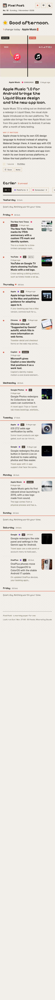
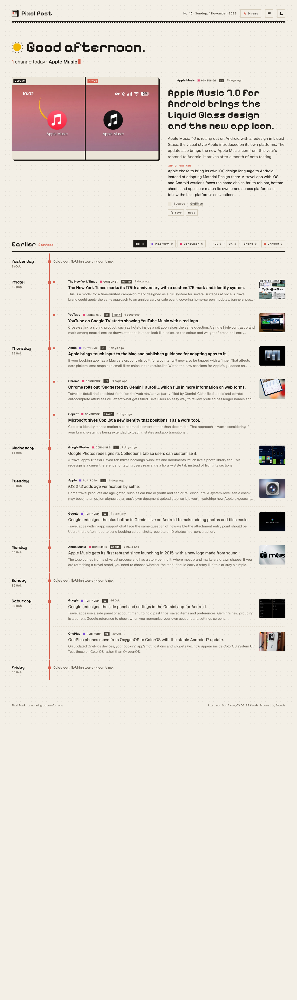

# Pixel Post

A morning paper for one: what apps, sites and brands changed in **UI design, UX and brand identity**, filtered so only real design changes get through. In English or Chinese.

Every morning at 07:00 a job on the laptop reads news feeds, applies strict rules, asks the company Claude (Opus 5.5) to pick what is worth your time and write it up, and uploads the result. GitHub then publishes it as a static page at https://kashif-08.github.io/design-updates/. Today's changes are on top; older days are listed below with a date rail, category filters and unread dots.

| Phone (375px) | Desktop (1280px) |
| --- | --- |
|  |  |

## How a run works

1. **Feeds.** Every RSS/Atom feed in `watchlist.yaml` is read: company newsrooms, tech news sites, and design and branding publications (It's Nice That, Dezeen, BP&O, PRINT and others).
1. **Store version notes (changes nobody announces).** The latest App Store and Google Play version of every watchlist app is read. A version not seen before, released inside the window, whose notes mention a design change (redesign, new look, layout, home, tab, navigation...) becomes a candidate like a news story. Boilerplate ("bug fixes and performance improvements") is ignored, so this fires rarely. What was seen is kept in `data/stores.json`, with each version's first App Store screenshot.
2. **Search (Anthropic API only).** One call per app group (OTAs, rail, platforms, consumer) with the web search tool, limited to the apps' own sites and the trusted outlets list. This catches newsrooms that have no feed. The company plan and Gemini have no working web search, so with those the run uses feeds only.
3. **Rules (no model).** Each item is dropped, with a reason, if it comes from a blocked or unknown site, has no real publish date or is older than 48 hours, has a drop word in the headline ("funding", "deals", "rumor"...), or was already reported. From news sites, an item must be about a watchlist app or have a design word in its headline (redesign, rebrand, new logo, interface, onboarding...). Everything from a design publication goes through. Search results are dated by the article page itself, not by the search engine.
4. **One curate call.** The model gets everything that passed, plus what was reported in the last two weeks. It keeps only design changes of three kinds: **UI** (the interface: redesigns, layout, visual style, icons, platform design rules), **UX** (how a flow works: navigation, onboarding, search, checkout, sign-in) and **Brand** (logos, identity, type, colour, app icons). Feature news with no visible design angle is dropped. Watchlist apps come first, but any well-known app, site or brand counts. It merges syndicated copies of one launch into one item (keeping the two best sources), drops the rest with a reason, and writes `headline`, `what` and `why` for each item in English and in Simplified Chinese (`zh`). It adds a `pattern` note (and `pattern_zh`) only when three or more apps moved the same way.
5. **Before and after.** For each kept UI or Brand item, the pictures in its source articles are read with their alt text, captions and file names. When those clearly say which picture is the old design and which the new ("Apple-Music-icon-old.jpg", "the previous logo"), the item gets a `compare` pair and the page shows them side by side. When only the new design is there, it replaces the generic photo. Unclear cases go to one small extra model call (`company.compare`, Haiku), which sees only those words and answers "not sure" rather than guess. Items from App Store notes show the previous version's screenshot next to the new one, when they differ.
6. **Checks.** The answer is validated in code: unknown apps, missing sources and incomplete write-ups are dropped; emojis and exclamation marks are removed; hype words are flagged in the log. Each kept page is re-read for its `og:image` and to make sure it is not an old story with a new date.
7. **Write.** `data/radar.json` gets a new day at the top. A quiet day is recorded as `"quiet": true` with no items. `data/seen.json` remembers every reported event, so a launch never shows up again on a later day. `data/runs.json` logs token use and estimated cost per run.

Running twice on the same day only adds genuinely new items to today. Past days are never rewritten. If no source could be read at all, the run fails and writes nothing, rather than claiming a quiet day.

## Commands

Needs Node 24 or newer. There are no npm packages to install.

```bash
npm run collect
```

Runs the job and prints what it kept and what it dropped, with the reason for each. Options (after `--`):

| Option | What it does |
| --- | --- |
| `--dry-run` | Read feeds and apply the rules, call no model, write nothing. |
| `--no-search` | Feeds only. |
| `--manual` | Do the model step by hand instead of using the API (see below). |
| `--gather-only` | Read sources and pages, save them to `.cache/`, stop. |
| `--from-cache` | Use the sources saved by `--gather-only` instead of reading the network. Good for trying another model on the same news. |
| `--backfill N` | Also fill the N−1 days before today, oldest first. Past days use feeds only. |
| `--data DIR` | Write `radar.json` and the rest to DIR instead of `data/`, for trial runs. |
| `--verbose` | List every dropped item, including the hundreds of old and off-topic ones. |

Other commands:

- `npm run check-feeds`: tests every feed URL and says how fresh each one is. Run it after adding a source.
- `npm run backfill-compare`: adds before/after pictures to items already in `radar.json` that have none, by re-reading their pages (`-- --dry-run` to only show what it would do). Only `compare` and `image` change.
- `npm run icons`: looks up app icons again (App Store artwork, or a favicon) and saves them to `data/icons.json`.
- `npm run build`: builds the site into `dist/`.
- `npm run dev`: builds and serves the site at http://localhost:5180.
- `npm test`: runs the tests.

### Which AI it uses

Set `provider:` in `watchlist.yaml`, or `RADAR_PROVIDER` in the environment, to one of:

| Provider | Where it works | Login | Web search |
| --- | --- | --- | --- |
| `company` | Your laptop only (Trip.com network) | Run `ada cc` once in Terminal, log in, type `/exit`. Model: `company.curate` (default `kr-claude-opus-5.5`) | No |
| `gemini` | GitHub only (Google blocks the API from mainland China) | `GEMINI_API_KEY`. Model: `gemini.curate` (default `gemini-3.8-flash`, free tier) | No |
| `anthropic` | Anywhere Anthropic serves | `ANTHROPIC_API_KEY` | Yes |

The morning job uses `company`. Keys for the other two go in `.env` (copy `.env.example`); it is git-ignored. If the company login expires, run `ada refresh` in Terminal and log in again.

Gemini was tried on GitHub in October 2026 and not used: it timed out on several calls, invented a detail, and dropped stories Opus kept.

### Running without a key

`npm run collect -- --manual` saves the model's question to `.cache/llm/requests/<id>.json` and stops. Write the JSON answer to the `answer_to` path in that file (for example by pasting the question into a Claude chat), then run the same command again. The second run reuses the sources saved the first time, so it works offline. Web search is skipped in this mode. The seed data in this repo (23 to 29 October 2026) was made this way from real feeds.

## Editing the watchlist

Everything is in `watchlist.yaml`; no code changes needed.

**Add an app.** Add an entry under one of the four groups:

```yaml
      - name: Kayak
        aliases: [Kayak]             # words that mark a headline as about this app (exact capitals)
        domains: [kayak.com]         # its own sites; count as first-party sources
        appstore_id: 305204535       # optional, for the icon
```

Then run `npm run icons` to fetch its icon. An app can only be in one group. The group decides its category dot on the page.

**Remove an app.** Delete its entry. Items already published stay in `radar.json`.

**Change what gets searched.** Each group has a `search:` list of starting queries. `models.searches_per_group` caps how many searches the model may run per group; set it to `0` to turn search off and cut cost.

**Change the rules.** `window_hours` (default 48), `trust.outlets` (sites trusted for search results), `trust.blocked_domains` (never kept) and `trust.drop_words` (headline words that drop an item before the model sees it). Keep drop words specific: `shares` alone would also drop "Apple shares new design guidance".

**Your name in the greeting.** Set `reader:`.

**Add a design source.** Add a feed with `kind: design`. Every item from it goes to the model, which names the brand, so use it only for publications that are mostly about design. Also add its domain to `trust.outlets`.

## Adding a source

Add a feed under `feeds:`:

```yaml
  - name: Kayak Newsroom
    url: https://www.kayak.com/news/feed/
    kind: company      # company: every item is about `app`
    app: Kayak         # outlet: items are matched to apps by alias instead
```

Run `npm run check-feeds` to confirm it works. If a site has no feed, add its domain to the app's `domains` (for a company) or to `trust.outlets` (for a news site) so the search step covers it instead.

When this was set up (October 2026) there was no working public feed for the Airbnb, Expedia Group, Agoda, Trainline and Omio newsrooms, Google Design / Material Design, or PhocusWire (it blocks automated readers). From the laptop's network, Brand New, Design Week, Creative Review, Creative Bloq and Fast Company Co.Design could not be reached either.

## The morning job (this Mac)

`scripts/daily.sh` runs the collector with the company Claude, then commits and uploads `data/` to GitHub, which republishes the page. macOS starts it at **07:00, 09:00, 12:00 and 16:00**; after the first successful run of the day, the later ones do nothing. So if the Mac was asleep or off the company network at 07:00, the next slot catches up.

- **Install or update:** `sh scripts/install-mac.sh` (add `--run-now` to start a test run straight away).
- **Remove:** `sh scripts/uninstall-mac.sh`.
- **Log:** `.cache/daily.log`. The last run's full output is in `.cache/last-run.txt`.
- **Run again today anyway:** `RADAR_FORCE=1 sh scripts/daily.sh`.
- **If something needs you,** a Mac notification says so: an expired company login (`ada refresh`), or an upload that failed (usually an expired GitHub token).

The Mac has to be awake at one of those times and able to reach the company AI server (`ada-cli-golang.ctripcorp.com`), which may need the office network or VPN. The upload uses the GitHub token saved in the macOS Keychain. Fine-grained tokens expire; when it does, make a new one (GitHub → Settings → Developer settings → Personal access tokens) and run `git push` once in Terminal to save it.

## Changing the run time

Edit the `HOURS` line in `scripts/install-mac.sh` (24-hour clock, this Mac's time zone), then run `sh scripts/install-mac.sh` again. The page's "today" follows `timezone:` in `watchlist.yaml`.

## Hosting on GitHub

The page is published by `.github/workflows/radar.yml` whenever `data/`, `site/`, `src/` or `watchlist.yaml` changes on `main`, or by hand (Actions tab → Publish page → Run workflow). It needs no secrets. While building, it copies app icons and source favicons into the site, because Google's and Apple's image servers may not load in mainland China. Article photos still load from the publishers' sites.

To set it up from scratch: create a repository, push this folder to `main`, and set Settings → Pages → Source to **GitHub Actions**.

## Cost

- **Company plan (in use):** about 0.6 credits a day with Opus 5.5 (4.4 for the test week; a busy day about 1.6). The run prints credits used. `kr-claude-opus-5` costs about a third less: set `company.curate` in `watchlist.yaml`.
- **Gemini:** free on the free tier.
- **Anthropic API:** one Sonnet curate call plus up to four Haiku search calls, about $0.15–0.35 a day.

Every run logs tokens (and credits or an estimated cost) to `data/runs.json`. Prices for the estimate are in `watchlist.yaml` under `prices:`.

## Files

```
watchlist.yaml        apps, feeds, search queries, trust rules
src/collect.ts        CLI for a run
src/run.ts            the run: gather → rules → curate → checks → write
src/prompts.ts        the prompts sent to Claude
src/prefilter.ts      rule checks before the model
src/curate.ts         the model call and the checks on its answer
src/radar.ts          append-only merge into radar.json, seen events
src/llm.ts            model access: company gateway, Gemini, Anthropic API, manual
src/mirror.ts         copies icons into the built site
scripts/daily.sh      the morning job on this Mac
scripts/install-mac.sh / uninstall-mac.sh   schedule it with macOS (launchd)
site/                 the page (plain HTML, CSS, JS)
data/radar.json       every day, newest first
data/seen.json        events already reported
data/runs.json        per-run token use and cost
data/icons.json       cached app icons
data/stores.json      last App Store / Google Play version seen per app
src/stores.ts         store version notes
src/compare.ts        before/after pictures
```

## The page

**Save and share.** Every item has a **star** and a **note**. The **Digest** button (top right) lists the week's starred items with your notes; add an intro and your name, then **Copy text** (for Feishu, WeChat or email, in the page's language) or **Copy link** (opens the same digest, read-only, for anyone; the items and notes travel in the link, nothing is uploaded). Stars and notes are kept in your browser only, so they don't follow you to another device.

English by default, with a **中 / EN** switch (top right) that changes everything on the page, including dates and each item's write-up, and is remembered in your browser. Items written before the Chinese write-ups were added (before 30 Oct 2026) stay in English. Light by default, with a dark mode toggle next to it. Each item has a **UI**, **UX** or **Brand** label, and the archive can be filtered by it. Pixelify Sans for headlines, Geist for reading. One coral-red accent (#D6614F); each category has its own square dot (OTA blue, rail green, platform violet, consumer pink). The timeline fills with the accent as you scroll. The logo is a pixel newspaper whose lines print in. Cards, dates and archive rows print in as they scroll into view, and images arrive blocky and sharpen in a few steps; items without an image show their app icon as a pixel mosaic. Unread dots mark items collected since your previous visit (kept in your browser's localStorage) and clear when you open an item. Motion is switched off when your system asks for reduced motion.
